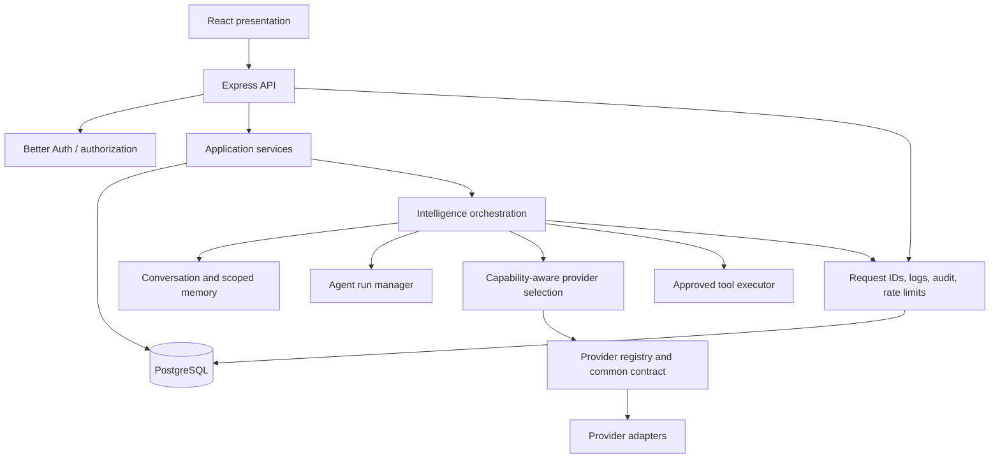

# AlphaTekx AI

AlphaTekx is a React/Vite application with an independent Node.js modular-monolith API and PostgreSQL persistence. Its AI assistant is named Biz. Provider credentials and authentication secrets are server-only.

## Architecture

The API owns request validation and authorization; services own application rules and persistence; the orchestrator depends on provider contracts rather than vendor SDKs. Project memory is only retrieved for its owning user and selected project, alongside that user's global memory.

## Requirements

- Node.js 20+
- Docker with Compose, or a PostgreSQL 15+ server
- npm

## Local development

1. Copy `.env.example` to `.env` and set a random `BETTER_AUTH_SECRET` of at least 32 characters. `.env.production.example` lists the production-only settings to provide through the deployment's secret manager.
2. Start PostgreSQL: `docker compose up -d postgres`.
3. Install packages: `npm install`.
4. Apply migrations: `npm run db:migrate`.
5. Start API, the separate job worker, and frontend: `npm run dev`.

The Vite development server proxies `/api` to `http://localhost:3001`; leave `VITE_API_URL` unset locally to use this proxy. Cloudflare Pages uses `functions/api/[[path]].js` to proxy same-origin `/api/*` requests to the Oracle API. In Cloudflare Pages build settings, leave `VITE_API_URL` empty or remove it; production builds use relative `/api` requests regardless. On the Oracle API host, set `WEB_ORIGIN=https://alphatekx-ai.pages.dev` and `BETTER_AUTH_URL=https://alphatekx-ai.pages.dev`. Better Auth trusts the frontend origin and sets production cookies as `SameSite=Lax; Secure`; the browser receives them from Pages through the proxy. The Google OAuth callback URI is `https://alphatekx-ai.pages.dev/api/auth/callback/google`. Keep the existing Nginx `/api/` proxy to `127.0.0.1:3001` and its redirect for other paths. Also set `NODE_ENV=production` and `DATABASE_URL`; set `PGSSLMODE=require` when the database host requires TLS.

## Authentication and mail

Authentication, sessions, password hashing, and TOTP MFA use Better Auth with PostgreSQL. Google sign-in is enabled only when `GOOGLE_CLIENT_ID` and `GOOGLE_CLIENT_SECRET` are set. Password recovery requires an SMTP host, credentials, and sender address; without them the server reports that recovery mail is not configured instead of claiming an email was sent. Set production cookie/origin values to the public application URL.

## AI providers

Provider adapters and registry are in `server/providers/`. The server supports OpenAI-compatible chat-completions APIs (OpenAI, DeepSeek, Mistral, Groq, xAI, OpenRouter, and two configurable Cloudflare Workers), Anthropic Messages, and Gemini `generateContent`. Configure the Workers with `AI_PROVIDER_URL_1` and `AI_PROVIDER_URL_2` in the server `.env`. Each is called directly with a JSON `{ messages }` body; no API key or model is required because the hosted Worker manages its own model. Worker 1 is selected by default when configured, and failures fall back to Worker 2. Set `AI_PROVIDER=worker1` to select it explicitly. Standard providers use their matching `*_API_KEY` and `AI_MODEL_*` variables.

Capability declarations are intentionally conservative. Model discovery is available through the authenticated providers API where the upstream provider exposes it. Image understanding, arbitrary document extraction, embeddings, and complete structured-output support are not enabled in the initial chat path. File uploads are private to the owning account; chat extraction currently supports plain text, Markdown, CSV, and JSON only. The local filesystem upload adapter requires a persistent, access-controlled volume in production.

The intelligence core routes simple questions to one model call. Requests classified as multi-step produce a model-generated task plan and a Research and Reasoning agent run before response synthesis; plan tasks, conversation messages, and the audit record are persisted in one database transaction. Chat is submitted as a durable PostgreSQL job and processed by a separately managed Node worker, so the HTTP request does not remain open while a model task runs. The registered tools include Tavily-backed `web_search` and workspace-scoped `file_list`, `file_read`, and `file_write`. Tool calls use permission checks, persisted audit events, the approval workflow, and worker continuation. Workspace access is limited to a per-user subfolder; absolute paths, traversal, symbolic links, `.env` files, and common credential/key paths are blocked. File reads and writes are capped at 256 KiB, and listings at 200 entries. `file_write` requires approval unless the owner explicitly allows it for the current workspace; grants can be revoked in Approvals. Arbitrary code execution remains disabled until a local operating-system sandbox can enforce filesystem and network isolation.

## Database and operations

SQL migrations are versioned in `server/db/migrations/` and run with `npm run db:migrate`. Authentication, user settings, conversations, messages, attachments, provider/model metadata, projects/tasks, durable jobs, agent/tool runs, memory, approval, integration credentials, and audit records are represented in versioned migrations.

Provider keys are read from server environment variables. Set `TAVILY_API_KEY` in the server-side worker environment to enable live web search; never place it in a `VITE_*` variable or browser storage. Set `AI_REVIEW_PROVIDERS` to explicitly enable independent reviews for complex tasks; review mode can be `parallel` or `sequential`. User integration credentials are encrypted with AES-256-GCM using a key derived from `BETTER_AUTH_SECRET`; rotate that secret only with a credential re-encryption plan. Configure a separate stable production secret and secure database/object-storage backups.

Every HTTP request receives a server-generated `X-Request-Id`; structured request logs and AI usage events use that correlation ID. Usage telemetry write failures are logged separately and do not replace a successful model response or mask a provider error. Chat is limited to 10 requests per authenticated user per minute per API process. Before running multiple API replicas, replace the in-process limiter with a shared store. Transient provider network, timeout, rate-limit, and upstream-server failures can trigger one alternate-provider attempt; non-retryable provider errors do not.

## Durable jobs and tool approvals

Run `npm run db:migrate` before starting the API and worker. `npm run dev` starts them as separate local processes; production should run `node server/index.js` and `node server/job-worker.js` as independent Oracle-managed services. The worker claims jobs with PostgreSQL row locks, renews a lease/heartbeat, exposes status/progress through `/api/jobs/:id`, handles cancellation, and requeues expired leases after a restart. The worker's current per-job ceiling is 15 minutes; the browser request only submits the job and polls its status.

`POST /api/chat` returns HTTP 202 with a job ID. The chat page polls `/api/jobs/:id`; `POST /api/jobs/:id/cancel` requests cancellation. A tool call requiring permission pauses as a pending approval; the owner approves or denies it from the Approvals page, and the API queues continuation for the worker instead of executing the tool in the HTTP process. To demonstrate the read-only loop, configure `TAVILY_API_KEY`, run all three local processes, ask “Search for [current topic]”, approve the `web_search` request at `/approvals`, and wait for the worker to return results to the model and finish the response. A worker restart can be exercised by submitting a queued/running job, stopping the worker, then restarting it after its lease expires; the same job ID remains available for polling.

On Oracle, keep the Express API, PostgreSQL, job worker, and tool execution on the Oracle side. Cloudflare may serve the static frontend and provide DNS, edge protection, or a same-origin API proxy; do not move Express or PostgreSQL jobs into Workers. Configure the API and worker as separate services. The worker needs database and model-provider credentials; the search subprocess is launched with a minimal environment containing only `TAVILY_API_KEY` (plus `SystemRoot` on Windows), and Node's permission mode limits file reads to `server/tools/runtime`. Keep secrets in the Oracle secret manager/systemd environment rather than committed files.

### Local workspace file tools

The local workspace defaults to `./workspace` under the project root; set server-side `WORKSPACE_DIR` to use another dedicated folder. Each signed-in user gets an isolated subfolder. `file_list` and `file_read` are read-only; `file_write` shows the exact proposed text in Approvals and requires explicit approval. The optional “Always allow file writes in this workspace” choice creates a user- and workspace-scoped grant, which can later be revoked from the same page. Every tool request writes an audit record containing the user, tool, timestamp, and a safe input summary (file writes include path, byte count, and content hash, not a second copy of the source).

Local demo: apply migrations, start `npm run dev`, and ask AlphaTekx to create `site/index.html` with a “Hello AlphaTekx” button and show the file. Review the proposed contents in **Approvals**, approve the write (optionally remembering permission), then let the worker read the saved file back into the conversation. The code-check step from the requested end-to-end demo is intentionally unavailable on this machine: Node's permission mode does not disable network access, and neither Docker nor WSL is installed. Do not run model-generated code in an unrestricted local subprocess; enable a proper OS sandbox before adding `run_code`. This work remains local and does not configure Cloudflare or Oracle.

### Open Markdown skills

Skills are optional Markdown guidance. The built-in tools remain available when no optional skill is enabled. Bundled examples and the built-in `create-skill` are under `skills/`; user-installed skills are stored separately under `skills/users/<user-hash>/<skill-name>/SKILL.md`, and enablement is per account. The loader scans the folder on API and worker startup and refreshes the current user's skills for each job. Invalid files are skipped and logged. Skills cannot execute code; ZIP uploads are accepted only when they contain one `SKILL.md` (and optionally its single top-level folder).

Frontmatter uses `name`, `description`, `version`, `permissions`, and `tools`. `permissions` must exactly match the registered tools' requirements. `tools` is an allowlist enforced both when validating a plan and immediately before dispatch; it does not grant permissions. Existing tool authorization, workspace restrictions, and file-write approvals still apply. Skills requesting `file_write` or other designated dangerous tools require a separate install/enable approval; file writes still require their normal action approval. A user-created skill is never able to execute JavaScript, Python, or shell code.

The authenticated `/api/skills` endpoint lists available and installed skills. `POST /api/skills/install` accepts a `SKILL.md` upload or restricted ZIP; `PATCH /api/skills/:name` enables/disables; `DELETE /api/skills/:name` removes a personal skill. Pending dangerous-skill requests are shown on **Approvals**. Install, enable/disable, removal, approval, and skill-use events are audited. User-installed skills are personal; bundled examples are shared read-only and can be individually enabled or disabled.

Local demos (after `npm run db:migrate`, then `npm run dev`):

1. **Zero optional skills:** On **Skills**, disable the two example skills and remove personal skills. Ask “Create hello.html”. The request still uses built-in file tools and follows the existing file-write approval. The built-in `create-skill` instruction remains available only for explicit skill-creation requests and does not match this goal.
2. **Example skill:** On **Skills**, install `skills/example-sell-skinsnap/SKILL.md`. Ask “Sell SkinSnap to UK companies”. Approve any `web_search` request; the assistant response shows **Used skill: example-sell-skinsnap**. Disable the skill to return to built-in-only matching.
3. **Create a skill:** Ask “Create a new skill for posting on X”. The creator researches with `web_search` when useful, then proposes a validated Markdown skill through the approval-gated `skill_create` tool. Approve the research and skill creation requests; if the generated skill requests a protected tool, approve its separate install request too. Confirm the new skill appears enabled on **Skills**. It uses a dedicated writer for the isolated skills directory rather than weakening workspace-only `file_write`.

The additive `005_open_skills.sql` migration adds per-user enablement and pending skill-install approvals. Apply it locally with `npm run db:migrate`; no production database or hosting configuration is changed.

### Oracle upload volume and backups

The upload adapter writes files beneath `UPLOAD_DIR`. In production, set this to an absolute path on an Oracle Block Volume mounted persistently, for example `/var/lib/alphatekx/uploads`; production startup rejects a relative path. Mount the same volume at that path for the API (read/write) and worker (read-only for attachment processing), and restrict directory ownership/permissions to the AlphaTekx service account. Do not rely on the container writable layer or the repository's local `./uploads` directory.

Enable scheduled OCI Block Volume backups (daily, with a retention period matching the data policy) and encrypted PostgreSQL backups. Keep the database and volume backups from a compatible time window so attachment rows do not outlive their files, and periodically test a restore to a separate volume/database before promoting it. Never delete or overwrite the existing upload directory as part of deployment; migrate/copy files with a verified backup and reconciliation plan.

## Checks

- `npm test` — unit tests for orchestration, providers, and credential protection.
- `npm run build` — frontend production build.
- `npm run lint` — ESLint.
- `npm run typecheck` — project type check.

## Data migration status

No hosted data or account export was available in this repository. Existing hosted users, MFA factors, conversations, and uploaded files have not been copied. Do not decommission the old deployment or assume account continuity until data export, mapping, backups, reconciliation, and a rollback plan are completed.

### Smart memory

Memory remains in the existing PostgreSQL `memory_records` table. Migration `006_smart_memory.sql` expands the supported kinds to `fact`, `preference`, `project`, and `lesson-learned` while retaining the legacy kinds and rows. After a successful chat or completed approval continuation, a bounded first-person phrase extractor saves recognizable names, preferences, project/business details, sales/work facts, and lessons. Preferences are global; other extracted facts inherit the current project when one is selected. Saves are deduplicated and written in the same transaction as the completed conversation.

This is deliberately a conservative keyword/phrase system, not an LLM memory writer or vector database. It only saves recognized patterns; it does not infer general facts from arbitrary prose or attachments. Passwords, credential/API-key terms and formats, email addresses, and selected sensitive personal identifiers are rejected both on manual memory writes and before saved memories are sent back as context. Relevant memories are selected by keyword and project scope; global preferences are included in new chats. The assistant message shows the memories used. Users can review, edit, or delete one or all saved memories at `/memory` or from Settings.

Local memory demo (after `npm run db:migrate`, then `npm run dev`):

1. In one chat, say “I like simple English”.
2. Start a new chat and ask “Write about SkinSnap”. The response should show **Using memories: Likes simple English**, and the preference should affect the response.
3. Say “My business is SkinSnap, I sell in UK”. Open **Memory** to see those two memories saved automatically. Try editing one, then deleting it; use **Delete all** to clear the account’s memories.

### Projects page and chat linking

The authenticated `/projects` page lists owned projects with task/job counts and task completion progress. Selecting a project shows its tasks, related durable jobs, project-scoped memories, and skills used in its conversations. Add a task and mark it complete from the task list. Deleting a project requires confirmation; project tasks and project-specific memories are deleted, task dependencies from other projects are detached, and conversation history/jobs remain.

Create projects either from the page or in a new chat with “Create project Stickman Videos”. In a later new chat, mention that project’s name to associate the job and any planned tasks with it. Existing conversations keep their current project association. Project names are matched only against projects owned by the signed-in user.

Local project demo:

1. In chat, say “Create project Stickman Videos”; open **Projects** and select it.
2. Add the task “Make 3 videos” and mark it complete. The progress indicator should update.
3. Send a new chat request mentioning “Stickman Videos”; its job should appear under that project. If the conversation creates a planned task, it is stored there as well.

All of these changes remain local. Apply migration 006 only to the intended local PostgreSQL database; no Cloudflare, Oracle, or production database changes are part of this work.
